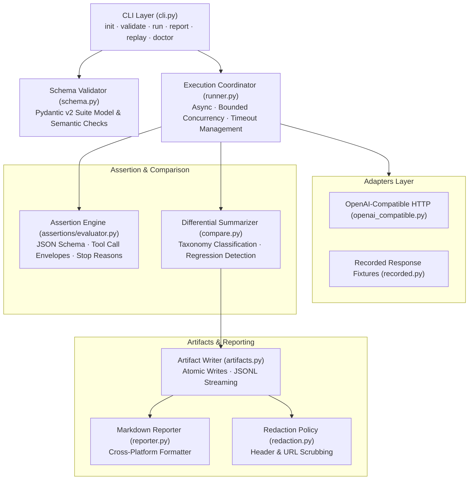

# ModelParity Architecture

## Overview

ModelParity is an open-source, local-first CLI tool for verifying user-defined behavior contracts across different LLM serving endpoints.

## Core Components

### 1. CLI Layer (`cli.py`)
Provides deterministic entrypoints (`init`, `validate`, `run`, `report`, `replay`, `doctor`) with stable exit codes suitable for CI environments.

### 2. Schema and Validation (`schema.py`)
Loads declarative test suites and performs strict schema validation before initiating any network requests. Validates duplicate test IDs and supported assertion types.

### 3. Execution Coordinator (`runner.py`)
Coordinates concurrent requests across the reference and candidate endpoints using `asyncio` and `httpx`. Normalizes vendor responses into a common provider-agnostic `NormalizedResponse` representation.

### 4. Adapter Interface (`adapters/`)
Abstracts model serving providers. Advertises explicit capability sets (`chat_completions`, `tool_calls`, `json_schema`, `finish_reason`, etc.).

### 5. Assertion Engine (`assertions/`)
Evaluates deterministic assertions independently on the reference and candidate responses.

### 6. Differential Summarizer (`compare.py`)
Computes per-test status transitions (e.g. `PASS -> FAIL`, `PASS -> PASS`) and classifies regressions without assuming free-form prose must match verbatim.

### 7. Artifact Writer & Reporting (`artifacts.py`, `reporter.py`)
Writes machine-readable reproducibility bundles (`run.json`, `suite.json`, `results.jsonl`, `summary.json`) atomically to disk, and produces plain Markdown reports.
